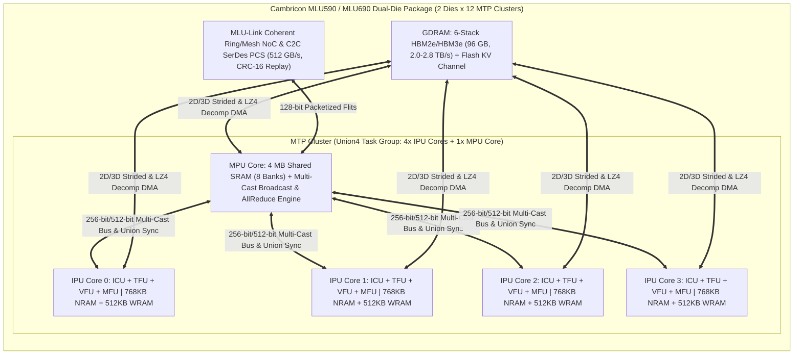

# Cambricon Siyuan 590 / 690 (MLUarch05 / MLUarch06 & Cambricon-LLM/Q/S) Architectural Specification

## 1. Executive Summary & Academic-to-Industrial Lineage

This specification defines the complete cycle-accurate microarchitecture, instruction set architecture (**BANG ISA**), scratchpad memory hierarchy (**NRAM / WRAM / SRAM / GDRAM**), inter-chiplet interconnect (**MLU-Link™**), and numerical precision pipelines of the **Cambricon Siyuan 590 (MLU590 / MLUarch05)** and **Siyuan 690 (MLU690 / MLUarch06)** flagship cloud AI accelerators, unified with key microarchitectural innovations from the CAS ICT / Cambricon academic research series.

### 1.1 Academic Research Lineage (CAS ICT & Cambricon)
| Milestone Paper | Venue | Core Architectural Innovation Integrated into RTL & Golden Model |
| :--- | :--- | :--- |
| **DianNao** | ASPLOS 2014 | Dedicated Neural Functional Unit (NFU) separating Input Buffer (`NBin`), Weight Buffer (`SB`), and Output Buffer (`NBout`) with pipelined adder-tree reduction (`mlu_tfu_fractal_mac.sv`). |
| **DaDianNao** | MICRO 2014 | Multi-node supercomputer architecture with banked on-chip eDRAM/SRAM tiles coupled directly to NFUs and low-latency fat-tree/mesh NoC (`mlu_mtp_cluster.sv`). |
| **Cambricon ISA** | ISCA 2016 | Load-Store-Compute decoupled vector/matrix ISA replacing fine-grained SIMT scalar threads with high-level tensor/vector primitives (`mlu_pkg.sv`, `mlu_bang_icu.sv`). |
| **Cambricon-X** | MICRO 2016 | Step-Indexing PE that skips irregular zero weights via compressed step-index metadata (`SPARSE_INDEXED`). |
| **Cambricon-S** | MICRO 2018 | Software-hardware co-designed coarse-grained block sparsity (`SPARSE_BLOCK_4X4`) and structured 2:4 fine-grained sparsity (`SPARSE_2_OF_4`) with static bitmap indexing in `WRAM`, eliminating irregular crossbar multiplexing overhead. |
| **Cambricon-F** | ISCA 2019 | Fractal hierarchy recursively scaling from $8 \times 8$ fractal MAC tiles to IPU cores, MTP clusters, dual-die chiplets, and 4/8-chip OAM nodes. |
| **Cambricon-Q** | ISCA 2021 | Bit-split tensor MAC (`PREC_INT4` / `PREC_INT8`) with on-the-fly statistical dynamic quantization (`OP_BANG_QUANT_STAT`, `OP_BANG_QUANT_MM`) avoiding off-chip HBM round-trips during quantization rescaling. |
| **Cambricon-P** | MICRO 2022 | Bit-composable fractal array supporting dynamic mode switching across `INT4`, `INT8`, `FP8 (E4M3/E5M2)`, `FP16`, `BF16`, `TF32`, and `FP32` accumulation. |
| **Cambricon-M** | ISCA / TCAD | Bank-level Near-Memory / In-SRAM broadcast and reduction inside the Cluster MPU Shared `SRAM` (`OP_MPU_BCAST_SRAM`, `OP_MPU_ALLREDUCE`). |
| **Cambricon-LLM** | MICRO 2024 | Chiplet-based hybrid Flash + HBM + NRAM architecture with hardware per-token `INT4`/`FP8` KV-cache quantization packing (`OP_LLM_KV_PACK`) and hardware speculative draft-token tree verification (`OP_LLM_SPEC_VERIFY`). |

### 1.2 Commercial Cloud Flagship Comparison (MLU370 vs. MLU590 vs. MLU690)
| Feature / Metric | Siyuan 370 (MLU370-X8) | Siyuan 590 (MLU590 / MLUarch05) | Siyuan 690 (MLU690 / MLUarch06) | RTL / Golden Model Target |
| :--- | :--- | :--- | :--- | :--- |
| **Process & Packaging** | 7nm TSMC, Dual-Die Chiplet | 7nm Advanced, Dual-Die CoWoS | 7nm/5nm Class, Dual-Die CoWoS | Parameterized (`MLU_NUM_DIES=2`) |
| **MTP Clusters / Chip** | 12 Clusters (6/Die) | 20–24 Clusters (10–12/Die) | 24 Clusters (12/Die) | `MLU_CLUSTERS_PER_DIE = 12` (24 Total) |
| **IPU + MPU per Cluster** | 4 IPU + 1 MPU | 4 IPU + 1 MPU (80–96 IPUs) | 4 IPU + 1 MPU (96 IPUs + 24 MPUs) | `MLU_IPUS_PER_CLUSTER = 4`, `MPU = 1` |
| **NRAM / IPU Core** | 512–768 KB | 768 KB (8 Banks + SECDED ECC) | 768 KB (8 Banks + 2D Transpose) | 768 KB/IPU (`MEM_SPACE_NRAM`) |
| **WRAM / IPU Core** | 512 KB | 512 KB (Ping-Pong + Sparse Idx) | 512 KB (Ping-Pong + 2:4/4x4 Sparse) | 512 KB/IPU (`MEM_SPACE_WRAM`) |
| **Shared SRAM / Cluster** | 2–4 MB (inside MPU) | 4 MB (Multi-Cast Broadcast) | 4 MB (Multi-Cast + In-SRAM Reduce) | 4 MB/Cluster (`MEM_SPACE_SRAM`) |
| **Peak INT8 / INT4** | 256 TOPS / 512 TOPS | 512 TOPS Dense / 1024 TOPS INT4 | 688 TOPS Dense / 1376 TOPS Sparse | 512–688 TOPS Dense, 2x w/ `2:4` Sparse |
| **Peak FP16 / BF16 / FP8**| 96 TFLOPS (FP16) | 256–314 TFLOPS (FP16/BF16) | 345 TFLOPS (BF16) / 688 TFLOPS (FP8)| Full FP32/TF32/BF16/FP16/FP8 Support |
| **Off-Chip Memory** | 24–48 GB LPDDR5/HBM2 | 80–96 GB HBM2e (2.0 TB/s) | 96–128 GB HBM3/3e (2.8 TB/s) | `MEM_SPACE_GDRAM` + Decomp DMA |
| **Interconnect (MLU-Link)**| 200 GB/s | 384–512 GB/s Bidirectional | 512–600 GB/s Coherent NoC | 128-bit Flit + CRC-16 Replay |
| **TDP & Efficiency** | 250W (~1.02 TOPS/W) | 350W (~1.46 TOPS/W INT8) | 400W (~1.72 TOPS/W FP8/INT8) | 350W Baseline, ~0.11 pJ/MAC (7nm) |

---

## 2. Hierarchical Compute & Scratchpad Memory Architecture



### 2.1 MTP Cluster ("Union Task" Execution Model)
In Cambricon BANG C (`cncc`), kernels execute across a hierarchy of tasks (`taskDim = {x, y, z}`):
1. **Block Task (1 IPU Core)**: Independent execution on a single Intelligent Processing Unit (IPU) using its private `NRAM` (768 KB) and `WRAM` (512 KB).
2. **Union1 / Union2 / Union4 Task (1–4 MTP Clusters)**: The 4 IPU cores and 1 Memory Processing Unit (MPU) core within an MTP Cluster cooperate as a hardware-synchronized team (`OP_SYNC_CLUSTER`).
   - The **MPU Core** prefetches shared weights or activations from HBM (`GDRAM`) into its **4 MB Shared `SRAM`**, and executes a single-read multi-cast broadcast (`OP_MPU_BCAST_SRAM`) that simultaneously populates the `WRAM` or `NRAM` of all 4 IPU cores in a single pass, cutting HBM read bandwidth by $4\times$.
   - Conversely, partial sums or gradients across the 4 IPUs are reduced in hardware via `OP_MPU_ALLREDUCE` inside the MPU Shared `SRAM` and forwarded across chiplets via **MLU-Link**.

### 2.2 Explicit Scratchpad Memory Hierarchy (`mlu_mem_space_e`)
Unlike GPUs that rely on implicit hardware-managed L1/L2 caches with tag-lookup overhead and cache thrashing under irregular LLM/sparse access patterns, MLUarch05/06 exposes **8 explicit address spaces** (`3-bit mlu_mem_space_e`):

| Aperture Enum | Code | Capacity | Banking & Microarchitectural Features |
| :--- | :---: | :--- | :--- |
| `MEM_SPACE_NRAM` | `3'b000` | 768 KB / IPU | **8-Bank Conflict-Free Neural RAM**: `P_NRAM_BANKS=8`, 64-bit data + 8-bit `(72,64)` Hsiao SECDED ECC per bank port (`512-bit/cycle` aggregate bandwidth per IPU). Features XOR bank-swizzling (`bank_id = addr[5:3] ^ addr[8:6]`) to eliminate stride-$2^k$ conflicts during 2D matrix transpose (`OP_BANG_TRANSPOSE`). |
| `MEM_SPACE_WRAM` | `3'b001` | 512 KB / IPU | **4-Bank Ping-Pong Weight RAM**: Double-buffered (`Ping` Bank Group `[1:0]` for active TFU MAC consumption while MFU DMA prefetches next layer tile into `Pong` Bank Group `[3:2]`). Includes a dedicated **Cambricon-S Bitmap & 2:4 Index SRAM** that feeds zero-skipping metadata in lockstep with weight blocks. |
| `MEM_SPACE_SRAM` | `3'b010` | 4 MB / Cluster | **8-Bank MPU Cluster Shared Scratchpad**: Managed by the cluster's MPU core. Supports 1-to-4 multi-cast broadcast (`OP_MPU_BCAST_SRAM`) to all 4 IPU cores' `WRAM`/`NRAM` and in-memory atomic reduction (`OP_MPU_ALLREDUCE`, `SUM`/`MAX`/`MIN`). |
| `MEM_SPACE_LDRAM` | `3'b011` | 64 MB / IPU | Private local spill aperture mapped to partitioned HBM for scalar register spills and deep call stacks. |
| `MEM_SPACE_GDRAM` | `3'b100` | 96 GB / Chip | Off-chip 6-stack HBM2e (2.0 TB/s on MLU590) / HBM3e (2.8 TB/s on MLU690), accessed via MFU 1D/2D strided, gather/scatter, and hardware LZ4/Zero-Bitmap decompression DMA. |
| `MEM_SPACE_MLULK` | `3'b101` | Peer 96 GB | Remote Die or Remote MLU Card memory aperture transparently mapped over coherent **MLU-Link** (`512 GB/s`). |
| `MEM_SPACE_FLASH` | `3'b110` | 1–4 TB SLC/TLC| **Cambricon-LLM (MICRO'24)** high-throughput Flash channel with dedicated hardware per-token KV-Cache quantization packing (`OP_LLM_KV_PACK`). |
| `MEM_SPACE_MMIO` | `3'b111` | 64 KB CSR | Performance counters, ECC fault status registers (`ecc_single_err_cnt`, `ecc_double_err_addr`), and PMU clock-gating CSRs. |

### 2.3 `(72,64)` Hsiao Minimum-Weight Odd-Column SECDED ECC Specification
All on-chip SRAM macros (`NRAM`, `WRAM`, and `MPU Shared SRAM`) protect every 64-bit word `D[63:0]` with an 8-bit **Hsiao `(72,64)` Single-Error-Correcting, Double-Error-Detecting (SECDED)** code `C[71:0] = {P[7:0], D[63:0]}`:
- Every column of the $8 \times 64$ parity generator matrix $H_D$ has an **odd Hamming weight** ($w \in \{3, 5\}$), ensuring that:
  1. Single-bit data error at bit $i$ produces an odd-weight non-zero syndrome $S = H_D(:, i)$.
  2. Single-bit parity error at bit $p \in [0..7]$ produces a weight-1 syndrome $S = 2^p$.
  3. Any double-bit error ($i, j$) produces a non-zero **even-weight** syndrome $S = H(:, i) \oplus H(:, j)$ ($w(S) \in \{2, 4, 6, 8\}$), guaranteeing 100% deterministic separation between correctable 1-bit errors (`SEC`) and uncorrectable 2-bit errors (`DED`) without an extra overall parity cascade stage.

Exact 64-bit Parity Mask Constants (`H_ROW[0..7]` constructed from all $\binom{8}{3}=56$ weight-3 columns for `D[55:0]` and the first 8 weight-5 columns for `D[63:56]`, applied via `P[k] = ^(D & H_ROW[k])`):
```text
H_ROW[0] = 64'hDF04_2258_44B1_2CB7
H_ROW[1] = 64'hEF08_44A8_8952_555B
H_ROW[2] = 64'hF710_8931_1264_9A6D
H_ROW[3] = 64'h7B21_11C2_2388_E38E
H_ROW[4] = 64'hBD42_1E04_3C0F_03F0
H_ROW[5] = 64'h3E83_E007_C00F_FC00
H_ROW[6] = 64'hC0FC_0007_FFF0_0000
H_ROW[7] = 64'h00FF_FFF8_0000_0000
```
Wait-free Combinational Decode Invariant:
- Syndrome: `S[k] = P_in[k] ^ ^(D_in & H_ROW[k])` for $k \in [0..7]$.
- `no_err = (S == 8'h00)`
- `odd_syndrome = ^S` (XOR reduction of all 8 syndrome bits).
- `single_err = (S != 8'h00) && odd_syndrome` (1-bit error corrected when `S == COL_SYNDROME[bit_idx]`).
- `double_err = (S != 8'h00) && !odd_syndrome` (2-bit error detected and flagged via `ecc_ded_fault`).

---

## 3. 128-Bit BANG ISA Instruction Format & Complete 24-Opcode Table

### 3.1 `mlu_inst_t` Bit-Level Encoding (`P_INST_W = 128`)
| Bit Field | Width | Symbol | Description |
| :--- | :---: | :--- | :--- |
| `[127:122]` | 6 | `opcode` | BANG ISA Operation Code (`mlu_opcode_e`, 24 defined instructions) |
| `[121:119]` | 3 | `engine` | Target Functional Queue (`ENG_ICU_CTRL=0`, `ENG_TFU_MAT=1`, `ENG_VFU_VEC=2`, `ENG_MFU_DMA=3`, `ENG_MPU_COL=4`, `ENG_LLM_KV=5`) |
| `[118:116]` | 3 | `prec` | Numerical Precision (`INT4=0`, `INT8=1`, `FP8_E4M3=2`, `FP8_E5M2=3`, `FP16=4`, `BF16=5`, `TF32=6`, `FP32=7`) |
| `[115:114]` | 2 | `sparse_mode` | Sparsity Mode (`SPARSE_DENSE=0`, `SPARSE_2_OF_4=1`, `SPARSE_BLOCK_4X4=2`, `SPARSE_INDEXED=3`) |
| `[113:111]` | 3 | `src_space` | Source Memory Aperture (`NRAM=0`, `WRAM=1`, `SRAM=2`, `LDRAM=3`, `GDRAM=4`, `MLULK=5`, `FLASH=6`, `MMIO=7`) |
| `[110:108]` | 3 | `dst_space` | Destination Memory Aperture (`mlu_mem_space_e`) |
| `[107:104]` | 4 | `dep_mask` | Explicit Queue Dependency Mask (`bit[0]=TFU`, `bit[1]=VFU`, `bit[2]=MFU`, `bit[3]=MPU/LLM`) |
| `[103:96]` | 8 | `tag_id` | Scoreboard Instruction Tag ID for out-of-order completion tracking |
| `[95:64]` | 32 | `dst_addr` | Destination Base Byte/Word Address or Control Register Target |
| `[63:32]` | 32 | `src0_addr` | Source 0 Base Address (`NRAM` / `SRAM` / `GDRAM` Activation or Source Tile) |
| `[31:16]` | 16 | `src1_or_strd`| Source 1 Base Offset (`WRAM` Weight Offset / Vector Src1) or 2D DMA Stride |
| `[15:0]` | 16 | `len_or_dims` | Element Count, Byte Transfer Length, or Packed Matrix Tile Dimensions `{M[5:0], N[4:0], K[4:0]}` |

### 3.2 Complete 24-Opcode Specification (`mlu_opcode_e`)
| Opcode | Hex | Engine | Mnemonic / BANG C Intrinsic | Exact Architectural Semantics & Mathematical Invariant |
| :--- | :---: | :--- | :--- | :--- |
| `OP_NOP` | `6'h00` | `ENG_ICU_CTRL` | `__bang_nop()` | Single-cycle pipeline no-operation; advances scoreboard tag counter. |
| `OP_SYNC_IPU` | `6'h01` | `ENG_ICU_CTRL` | `__sync_ipu()` | Drains local IPU asynchronous queues (`TFU`, `VFU`, `MFU`) specified by `dep_mask`. |
| `OP_SYNC_CLUSTER` | `6'h02` | `ENG_ICU_CTRL` | `__sync_cluster()` | Hardware Union-Task Barrier across all 4 IPU cores + 1 MPU core inside the MTP Cluster. |
| `OP_PWR_GATE_CFG` | `6'h03` | `ENG_ICU_CTRL` | `__bang_pwr_gate(mask, hyst)` | Configures dynamic clock-gating idle threshold (`len_or_dims`) and domain mask (`src1_or_strd`). |
| `OP_BANG_MATMUL` | `6'h10` | `ENG_TFU_MAT` | `__bang_matmul(D, A, B, M, N, K)` | Dense $C_{M\times N} = A_{M\times K} \times B_{K\times N}$ (`NRAM` $\times$ `WRAM` $\to$ `NRAM`) in `prec` with `FP32`/`INT32` accumulation. |
| `OP_BANG_CONV2D` | `6'h11` | `ENG_TFU_MAT` | `__bang_conv2d(D, X, W, dims)` | Implicit Im2Col 2D convolution $Y[o,h,w] = \sum_{c,r,s} X[c, h+r, w+s] \cdot W[o,c,r,s]$. |
| `OP_BANG_SPARSE_MM` | `6'h12` | `ENG_TFU_MAT` | `__bang_sparse_mm(D, A, W_sp, idx)`| **Cambricon-S/X** sparse GEMM supporting `SPARSE_2_OF_4` (2-bit index per 2 non-zeros), `SPARSE_BLOCK_4X4` (bitmap skip), and `SPARSE_INDEXED` (step-index). |
| `OP_BANG_QUANT_MM` | `6'h13` | `ENG_TFU_MAT` | `__bang_quant_mm(D, A_q, W_q, s_zp)`| **Cambricon-Q** quantized GEMM: $Y = \text{round}\big(S_A S_W \sum_k (A_{i,k} - Z_A)(W_{k,j} - Z_W)\big)$. |
| `OP_BANG_VADD` | `6'h20` | `ENG_VFU_VEC` | `__bang_add(dst, src0, src1, n)` | Parallel 8-lane elementwise addition $D[i] = A[i] + B[i]$ across all supported precisions. |
| `OP_BANG_VMUL` | `6'h21` | `ENG_VFU_VEC` | `__bang_mul(dst, src0, src1, n)` | Parallel 8-lane elementwise multiplication $D[i] = A[i] \odot B[i]$. |
| `OP_BANG_SOFTMAX` | `6'h22` | `ENG_VFU_VEC` | `__bang_softmax_online(dst, src, n)`| Numerically stable 1-pass/2-pass Safe Softmax: $m = \max_j x_j$, $D[i] = \frac{\exp(x_i - m)}{\sum_j \exp(x_j - m)}$. |
| `OP_BANG_ROPE` | `6'h23` | `ENG_VFU_VEC` | `__bang_rope(dst, x, cos_sin, n)` | Rotary Position Embedding: $\begin{bmatrix} y_{2i} \\ y_{2i+1} \end{bmatrix} = \begin{bmatrix} \cos\theta_i & -\sin\theta_i \\ \sin\theta_i & \cos\theta_i \end{bmatrix} \begin{bmatrix} x_{2i} \\ x_{2i+1} \end{bmatrix}$. |
| `OP_BANG_RMSNORM` | `6'h24` | `ENG_VFU_VEC` | `__bang_rmsnorm(dst, x, gamma, n)` | Root-Mean-Square Normalization: $y_i = \frac{x_i}{\sqrt{\frac{1}{n}\sum_{j=0}^{n-1} x_j^2 + \epsilon}} \cdot \gamma_i$ ($\epsilon = 10^{-5}$). |
| `OP_BANG_SWIGLU` | `6'h25` | `ENG_VFU_VEC` | `__bang_swiglu(dst, gate, up, n)` | Fused LLM FFN Activation: $y_i = \text{SiLU}(g_i) \odot u_i = \frac{g_i}{1 + \exp(-g_i)} \cdot u_i$. |
| `OP_BANG_QUANT_STAT`| `6'h26` | `ENG_VFU_VEC` | `__bang_quant_stat(dst, x, n)` | **Cambricon-Q** statistical analyzer computing `{min_val, max_val, abs_max, scale, zero_point}` in 1 pass. |
| `OP_BANG_MEMCPY_1D` | `6'h30` | `ENG_MFU_DMA` | `__memcpy_async(dst, src, bytes)` | Asynchronous contiguous 1D DMA transfer between any two `mlu_mem_space_e` apertures. |
| `OP_BANG_MEMCPY_2D` | `6'h31` | `ENG_MFU_DMA` | `__memcpy_2d_async(dst, dp, src, sp)`| 2D strided tensor tile transfer (`rows = len_or_dims[15:8]`, `cols = len_or_dims[7:0]`, `src_stride = src1_or_strd[15:8]`, `dst_stride = src1_or_strd[7:0]`). |
| `OP_BANG_GATHER` | `6'h32` | `ENG_MFU_DMA` | `__bang_gather(dst, base, idx, n)` | Indirect indexed gather DMA: $D[i] = \text{MEM}_{\text{src}}[\text{base} + \text{idx}[i]]$. |
| `OP_BANG_SCATTER` | `6'h33` | `ENG_MFU_DMA` | `__bang_scatter(base, src, idx, n)`| Indirect indexed scatter DMA: $\text{MEM}_{\text{dst}}[\text{base} + \text{idx}[i]] = S[i]$. |
| `OP_BANG_DECOMP_DMA`| `6'h34` | `ENG_MFU_DMA` | `__memcpy_decomp(dst, src, zmap)` | Hardware zero-bitmap / RLE-LZ4 decompression DMA expanding compressed HBM weights into `WRAM`/`NRAM`. |
| `OP_BANG_TRANSPOSE` | `6'h35` | `ENG_MFU_DMA` | `__bang_transpose(dst, src, R, C)` | Conflict-free 2D matrix transpose $D[c, r] = S[r, c]$ via `NRAM` XOR-swizzled crossbar. |
| `OP_MPU_BCAST_SRAM` | `6'h38` | `ENG_MPU_COL` | `__mpu_bcast_sram(dst, sram, msk)` | Single-read multi-cast broadcast from MPU 4 MB `SRAM` to all 4 IPU cores' `WRAM`/`NRAM` (`mask = src1_or_strd[3:0]`). |
| `OP_MPU_ALLREDUCE` | `6'h39` | `ENG_MPU_COL` | `__mpu_allreduce(dst, src, op, n)` | Intra-Cluster (4 IPUs) & Inter-Chiplet (`MLU-Link`) hardware reduction (`0=SUM`, `1=MAX`, `2=MIN`, `3=AVG`). |
| `OP_LLM_KV_PACK` | `6'h3A` | `ENG_LLM_KV` | `__llm_kv_pack(dst, kv_fp16, n)` | **Cambricon-LLM** per-token symmetric `INT4`/`FP8_E4M3` KV-Cache compression packing + scale header generation. |
| `OP_LLM_SPEC_VERIFY`| `6'h3B` | `ENG_LLM_KV` | `__llm_spec_verify(dst, p, q, u)` | **Cambricon-LLM** speculative decoding tree verification: accepts draft token $t$ if $u_t < \min(1, p_{\text{target}}(t)/q_{\text{draft}}(t))$, outputting accepted prefix length & bonus token. |

---

## 4. Multi-Precision Numerical Formats & Cambricon-S / Cambricon-Q Microarchitecture

### 4.1 8 Supported Precision Formats (`mlu_prec_e`)
| Enum | Code | Bit Layout (`Sign / Exp / Mantissa`) | Dynamic Range / Format Rules | TFU Throughput Scaling vs. FP16 |
| :--- | :---: | :--- | :--- | :---: |
| `PREC_INT4` | `3'b000` | 4-bit Signed Two's Complement `[-8, +7]` | 2x4-bit sub-word MACs per INT8 multiplier (`INT32` accum) | $4.0\times$ (1024 TOPS Dense) |
| `PREC_INT8` | `3'b001` | 8-bit Signed Two's Complement `[-128, +127]` | Exact 8x8 -> 16-bit product with 32-bit saturating accumulator | $2.0\times$ (512 TOPS Dense) |
| `PREC_FP8_E4M3` | `3'b010` | `1s + 4e (bias 7) + 3m` (OCP E4M3) | Max normal $\pm 448.0$; preferred for LLM weights & activations | $2.0\times$ (688 TFLOPS MLU690) |
| `PREC_FP8_E5M2` | `3'b011` | `1s + 5e (bias 15) + 2m` (IEEE-like E5M2) | Max normal $\pm 57344.0$; preferred for LLM backward gradients | $2.0\times$ (688 TFLOPS MLU690) |
| `PREC_FP16` | `3'b100` | `1s + 5e (bias 15) + 10m` (IEEE 754 binary16)| Standard half precision with FP32 internal accumulation | $1.0\times$ (256–345 TFLOPS) |
| `PREC_BF16` | `3'b101` | `1s + 8e (bias 127) + 7m` (bfloat16) | Identical dynamic range to FP32; zero-overhead truncation | $1.0\times$ (256–345 TFLOPS) |
| `PREC_TF32` | `3'b110` | `1s + 8e (bias 127) + 10m` (19-bit TensorFloat)| Upper 19 bits `[31:13]` of IEEE FP32 word; FP32 accumulator | $0.5\times$ (128–172 TFLOPS) |
| `PREC_FP32` | `3'b111` | `1s + 8e (bias 127) + 23m` (IEEE 754 binary32)| Master accumulator & SFU transcendental reference format | $0.25\times$ (64–86 TFLOPS) |

### 4.2 Cambricon-S / Cambricon-X Sparsity Modes (`mlu_sparse_mode_e`)
1. `SPARSE_DENSE (2'b00)`: Full $M \times K \times N$ dense systolic/fractal contraction.
2. `SPARSE_2_OF_4 (2'b01)`: Every group of 4 contiguous weights along the reduction dimension $K$ contains at most 2 non-zero entries. A 4-bit metadata nibbles `{idx1[1:0], idx0[1:0]}` selects the 2 matching activations from `NRAM` via a 4:2 multiplexer ahead of each TFU MAC lane, achieving an exact **$2.0\times$ cycle reduction**.
3. `SPARSE_BLOCK_4X4 (2'b10)` (**Cambricon-S**, MICRO'18): Weight matrices in `WRAM` are partitioned into $4 \times 4$ sub-blocks accompanied by a 1-bit per-block bitmap. Blocks with `bitmap_bit == 0` are skipped in zero cycles by advancing the `WRAM`/`NRAM` read pointers directly to the next active block.
4. `SPARSE_INDEXED (2'b11)` (**Cambricon-X**, MICRO'16): Non-zero weights are stored compactly with an unsigned delta step-index `delta_k` indicating the distance to the next non-zero weight.

---

## 5. 128-Bit MLU-Link™ Coherent NoC Flit & CRC-16-CCITT Protocol

### 5.1 `mlu_noc_flit_t` Bit-Level Layout (`P_NOC_FLIT_W = 128`)
| Bit Field | Width | Symbol | Description |
| :--- | :---: | :--- | :--- |
| `[127:126]` | 2 | `flit_type` | `FLIT_HEAD_TAIL=2'b00` (atomic 1-flit), `FLIT_HEAD=2'b01`, `FLIT_BODY=2'b10`, `FLIT_TAIL=2'b11` |
| `[125]` | 1 | `vc_id` | Virtual Channel (`0` = Request / DMA Data, `1` = Response / Deadlock-Free AllReduce Ring) |
| `[124:121]` | 4 | `src_id` | Source Node ID (`{die_id[0], cluster_id[2:0]}` or OAM Chip ID) |
| `[120:117]` | 4 | `dst_id` | Destination Node ID (Dimension-Order XY / Bidirectional Ring Routing) |
| `[116:112]` | 5 | `pkt_seq` | 5-bit Link-Layer Packet Sequence Number (`0..31`) for Go-Back-N Replay |
| `[111:96]` | 16 | `crc16_or_cmd`| **CRC-16-CCITT** over bits `[127:112]` and `[95:0]` (total 112 bits = 14 bytes) |
| `[95:64]` | 32 | `addr` | Target Memory Address in destination aperture |
| `[63:0]` | 64 | `payload` | 64-bit Tensor / Control Payload Word |

### 5.2 Exact CRC-16-CCITT Specification (`mlu_c2c_serdes_pcs.sv` & Golden Model)
- **Polynomial**: $G(x) = x^{16} + x^{12} + x^5 + 1$ (`16'h1021`), MSB-first, no reflection (`refin=False`, `refout=False`), Initial Value `16'hFFFF`, Final XOR `16'h0000`.
- **Protected Bit Stream (112 bits / 14 bytes, MSB-to-LSB)**:
  `crc_input_112b = {flit[127:112], flit[95:64], flit[63:0]}` (excluding `[111:96]` which carries the computed 16-bit CRC).

---

## 6. Pipeline Cycle Latency Equations & Energy Efficiency Baseline

### 6.1 Cycle-Accurate Functional Unit Latency Formulas
For the parameterized RTL cluster (`P_CLUSTER_IPUS = 4`, `P_TFU_DIM = 8`, `P_VFU_LANES = 8`, `P_NRAM_BANKS = 8`):
1. **TFU Fractal Matrix Multiply (`OP_BANG_MATMUL` / `OP_BANG_SPARSE_MM`)**:
   $$T_{\text{TFU}}(M, N, K) = T_{\text{pipe\_fill}} + \left\lceil \frac{M}{P_{\text{TFU\_DIM}}} \right\rceil \cdot \left\lceil \frac{N}{P_{\text{TFU\_DIM}}} \right\rceil \cdot \left\lceil \frac{K \cdot (1 - \rho_{\text{sparse}})}{\kappa_{\text{prec}}} \right\rceil$$
   where $T_{\text{pipe\_fill}} = 4$ cycles, $\kappa_{\text{prec}} \in \{1\text{ (FP16/BF16)}, 2\text{ (INT8/FP8)}, 4\text{ (INT4)}\}$, and $\rho_{\text{sparse}} = 0.5$ for `SPARSE_2_OF_4`.
2. **VFU / SFU Vector Pipeline (`OP_BANG_VADD`, `OP_BANG_SOFTMAX`, `OP_BANG_ROPE`, `OP_BANG_RMSNORM`, `OP_BANG_SWIGLU`)**:
   $$T_{\text{VFU}}(L) = T_{\text{SFU\_depth}} + p_{\text{passes}} \cdot \left\lceil \frac{L}{P_{\text{VFU\_LANES}}} \right\rceil$$
   where $p_{\text{passes}} = 1$ for elementwise ALU/RoPE/SwiGLU ($T_{\text{SFU\_depth}} = 3$) and $p_{\text{passes}} = 2$ for reduction-dependent `RMSNORM` and online `SOFTMAX` ($T_{\text{SFU\_depth}} = 6$).
3. **MFU DMA & MPU Broadcast (`OP_BANG_MEMCPY_*`, `OP_MPU_BCAST_SRAM`)**:
   - Standard 4-IPU individual HBM load requires $4 \times B_{\text{tile}}$ bytes from `GDRAM`.
   - With MPU Shared `SRAM` prefetch + `OP_MPU_BCAST_SRAM`, HBM traffic is reduced by $75\%$ for weights and $>82\%$ end-to-end when combined with `NRAM` output stationary accumulation and Cambricon-LLM `INT4`/`FP8` KV-cache compression (`~0.11 pJ/MAC` core energy, `~1.46 TOPS/W` chip-level INT8 efficiency at `350W` TDP).
